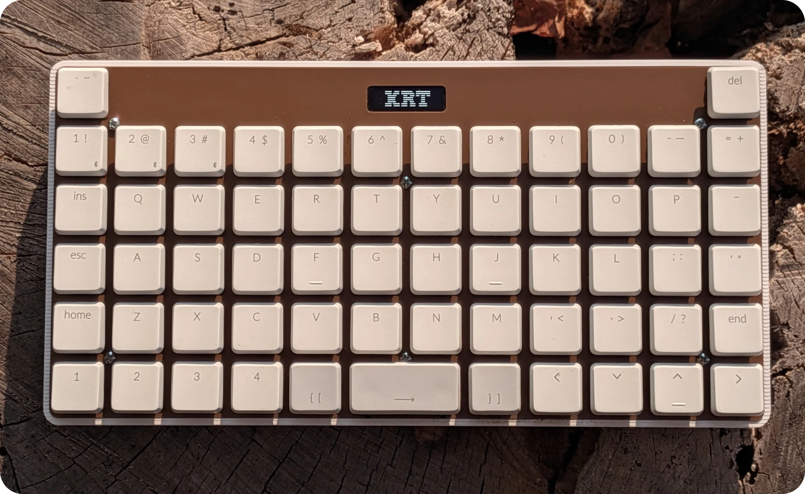
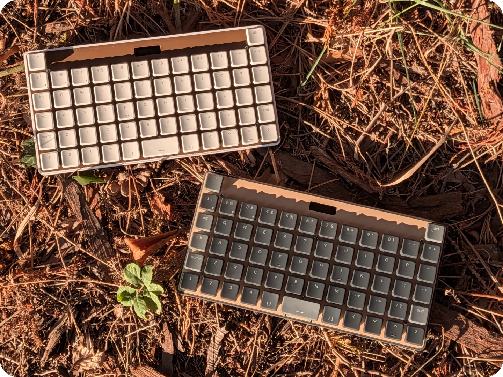
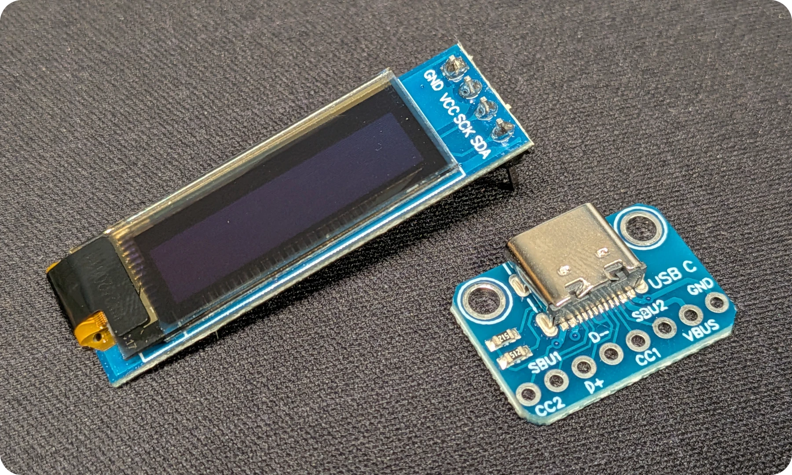

# Krteq

[](#pcb)
[](#case)
[](#firmware)

An extended 5x12 keyboard with 2 extra keys. Intended for ortho layouts with a shifted number row, allowing for the placement of the delete and tilde keys above their usual spots.

Krteq is a successor to [Krtkus](https://github.com/swift502/Krtkus), learning from its lessons to make a design that's better encapsulated and much more complete.

### Features

- Low profile
- Hotswap
- RGB backlight
- QMK/VIA compatible
- 3D printed case with a 7 degree tilt
- Tray mount
- 233mm × 121mm × 30mm

Connecting the keyboard to [usevia.app](https://usevia.app) requires manually uploading the [design file](production/krteq_via.json) in the design tab.



## Build guide

### Parts

- [PCB](#pcb)
- [Case](#case)
- Keycaps
- 61x Gateron KS-33 switch
- Gateron 2u low profile plate-mounted stabilizer

<!-- -->

- Raspberry Pi Pico
- USB-C breakout board
- OLED display module

<!-- -->

- 11x connecting wire
- 6x M2x8 screw
- 2x M2.5x6 screw
- Rubber feet

TODO: Use 8x 2,2x8mm thread-forming screws for plastic

### Breakout boards

The **USB-C breakout board** is expected to match the specs of the Adafruit USB-C breakout board with two M2.5 screw holes 15.24mm apart, 2.54mm from the front edge, and built-in resistors for the CC lines.

The **OLED display module** is expected to be a 128x32 I2C OLED screen. These screens are not very standardized, so the PCB cutout is generous to fit modules with slightly different dimensions. Any OLED roughly equal or less than 38x12mm should fit, and at most require slight modifications to the display cutout in the plate.



### Assembly

1. Perform the initial firmware flash on the Pico
1. Attach the stabilizer to the plate
1. Place the OLED module into plate's display slot
1. Screw the USB board to the plate
1. Solder the Pico onto the PCB via pin headers
1. Secure the plate to the PCB by installing the switches
1. TODO: Suggest good wire lengths
1. Solder wires between the J1, J2 and J3 interfaces and their respective breakout boards
1. Screw the plate to the case
1. Put some keycaps on and you're done!

## PCB

The Kicad 10 project can be found in [source/kicad](source/kicad). All parts are SMD, the PCB is intended to be ordered with pre-assembled SMD components for an easier, although more expensive build process.

To generate fabrication files, open the Kicad project and use an export plugin provided by the PCB manufacturer you want to order from. The order process is then highly dependent on the manufacturer.

### Suggested BOM

| Part | Package | Manufacturer Part Number |
|---|---|---|
| Switch diode | SOD-123 | 1N4148W |
| Switch socket | SMD | KS-2P02B01-02 |
| RGB LED | SMD-4P,3.2x1.3mm | A-SP1513R6GHB1C-A01-2A (considering 23-23B/R6GHBHC-A30/2A) |
| RGB driver | QFN-48-EP(6x6) | IS31FL3733B-QFLS4-TR |
| 0.1µF capacitor | 0402 | CL05B104KO5NNNC |
| 0.47µF capacitor | 0603 | CL10B474KA8NNNC |
| 22µF/10V capacitor | CASE-A-3216-18(mm) | T520A226M010ATE080 |
| 2kΩ resistor | 0603 | 0603WAF2001T5E |
| 20kΩ resistor | 0603 | 0603WAF2002T5E |
| 100kΩ resistor | 0603 | 0603WAF1003T5E |

TODO: Use 23-23B/R6GHBHC-A30/2A for the LED

## Case

Case blend file can be found in [source/Krteq.blend](source/Krteq.blend). It's designed non-destructively, so it should be fairly easy to modify if needed.

STL files for 3D printing can be found in [production/stl](production/stl). Recommended printing parameters are:

- PLA
- 0.15mm layer height
- 100% infill

The plate has a "keychron" variant, which adjusts stabilizer cutouts for their non-standard [triangular stem design](https://www.keychron.com/blogs/news/the-design-details-of-our-keychron-low-profile-keyboard-stabilizers).

## Firmware

QMK/VIA setup with a few custom features:

- custom keycodes for volume, screen and RGB control
- pressing <kbd>LShift</kbd> + <kbd>RShift</kbd> + <kbd>B</kbd> enters bootloader mode
- pressing <kbd>LShift</kbd> + <kbd>RShift</kbd> + <kbd>C</kbd> reverts to the default keymap

### Adding custom OLED screens

In QMK, user keymaps can completely override oled rendering via `oled_task_user()`. However, Krteq also exposes its custom screen system, where screen interaction is done via the `KRT_SCR` keycode. Hooking into this system is preferred as it ensures that other built-in system screen features continue to work properly.

Here's a minimal example of a custom screen definition in a user keymap:

```c
// 1. Create a render function
static void custom_screen_render(void)
{
    oled_write_P(PSTR("Hello world"), false);
}

// 2. Construct a screen instance
static const krteq_screen_t custom_screen = {
    .name = "Custom screen",
    .start = custom_screen_render,
};

// 3. Override built-in screen list
const krteq_screen_t *const user_screens[] = {
    &custom_screen
};
```

Here's a table of fields and callbacks available for screens to implement:

| Property     | Description |
| ------------ | ----------- |
| `.name`      | Display name string |
| `.init`      | Runs once on keyboard start-up |
| `.start`     | Runs every time the screen is activated |
| `.update`    | Runs every OLED task cycle when screen is active |
| `.key_event` | Key press event |

You can combine custom screens with the built-in ones. You can reshuffle them, remove some and add your own. The built-in screen list goes as follows:

```c
const krteq_screen_t *const user_screens[] = {
    &krteq_screen_indicators,
    &krteq_screen_bongo_cat,
    &krteq_screen_game_of_life,
    &krteq_screen_waves,
    &krteq_screen_ball_pit,
    &krteq_screen_system_info
};
```

### Compiling (Windows)

Install:

- Python: https://www.python.org/
- MSYS: https://msys.qmk.fm

Run the compile script:

```sh
python source/scripts/qmk_compile.py
```

### Flashing (Windows)

For the initial flash, hold the BOOTSEL button while connecting the Pico to a computer to have it show up as a storage device, then copy the compiled [firmware file](production/krteq_firmware.uf2) over to it.

Once flashed, you can trigger the bootloader mode again by simply pressing the <kbd>LShift</kbd> + <kbd>RShift</kbd> + <kbd>B</kbd> key combination.

## Documentation

### QMK

- Info.json: https://docs.qmk.fm/reference_info_json
- Keycodes: https://docs.qmk.fm/keycodes
- Default keymap: https://docs.qmk.fm/configurator_default_keymaps
- RGB matrix: https://docs.qmk.fm/features/rgb_matrix
- OLED: https://docs.qmk.fm/features/oled_driver